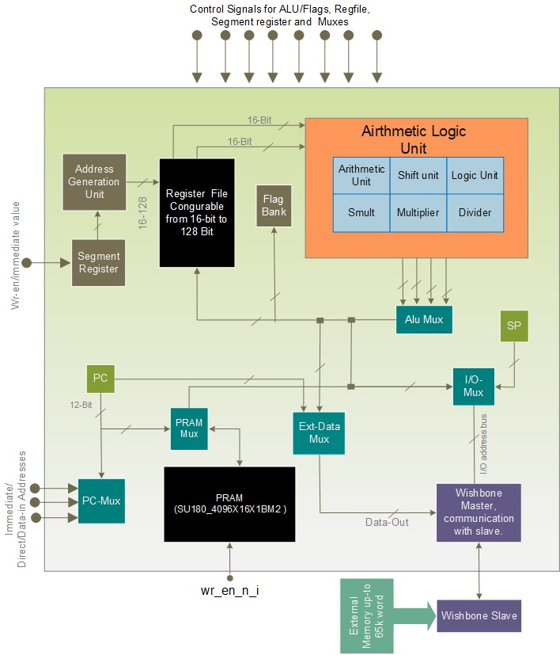
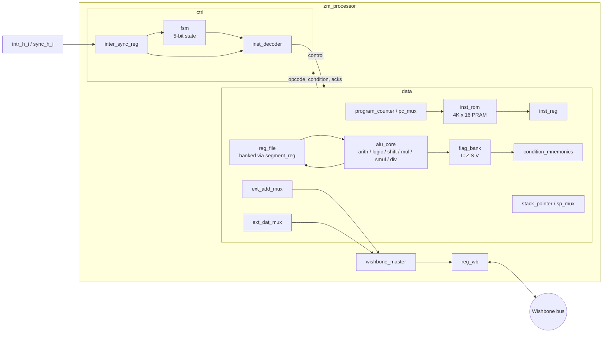
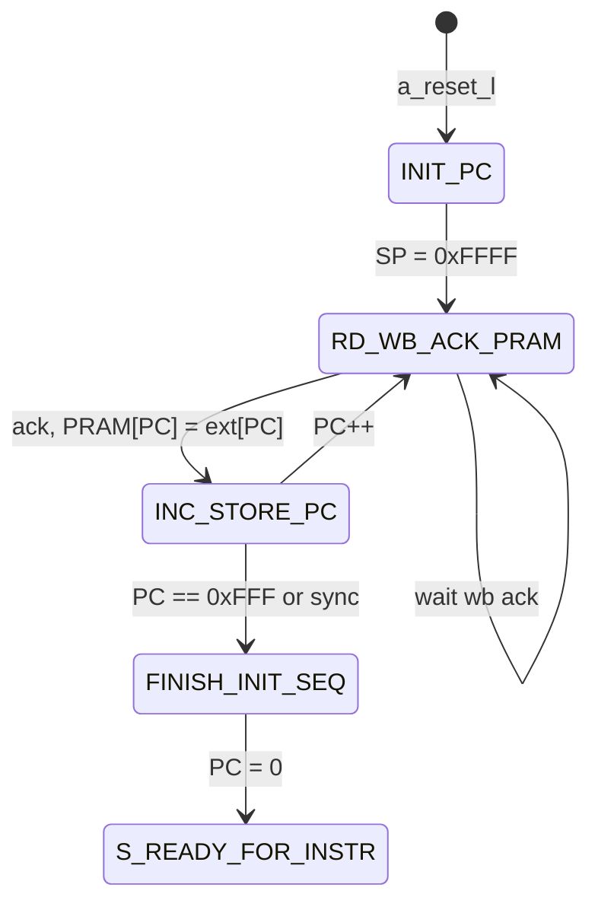
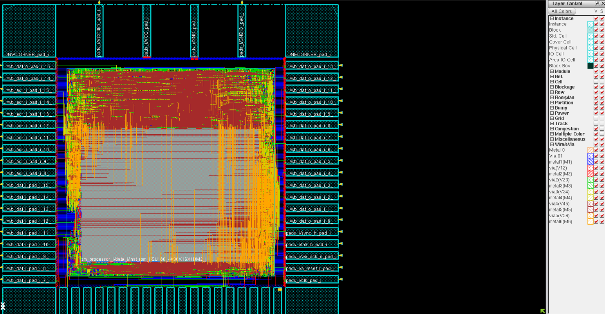

# 16-bit Microcontroller based on ZMC ISA

A small 16-bit microcontroller single pipelined core written in plain Verilog (2018). Its features:

- 12-bit program counter and a 4K x 16 on-chip program RAM (PRAM).
- Banked register file.
- Hardware multiply and divide.
- Interrupt and sync inputs.
- A Wishbone master for external data memory, I/O and the stack.
- Max acheivable Freq ~ 100 Mhz
- Optimized for Area (Single Airthmetic for most of ALU operations) 

At reset, the core copies its program from external memory into the PRAM over Wishbone. It then runs from PRAM address `0x000`.

## Directory structure

```
zm_processor/
├── source/
│   ├── verilog/rtl/      synthesizable RTL (top: zm_processor.v)
│   ├── verilog/beh/      behavioural models: inst_rom.v (PRAM wrapper), wishbone_slave.v, ext_mem.v
│   ├── verilog/tb/       tb_zm_processor.v
│   └── sv/beh/           sram_2048x64_sp.sv (generic SRAM model used by inst_rom)
└── simulation/
    ├── xcelium/          testcase.v, mem.mem, example programs (linear_search/)
    └── verilator/        Verilator + GTKWave setup (Makefile, sim_top.v, sim_main.cpp)
```

## Top level: `zm_processor`

### Parameters

| Parameter           | Default          | Description                                                               |
|---------------------|------------------|---------------------------------------------------------------------------|
| `MEM_DEPTH`         | 128              | Number of physical registers in the register file                         |
| `SEG_WIDTH`         | `MEM_DEPTH >> 5` | Width of the segment (bank) register. 4 with the default `MEM_DEPTH`     |
| `INTRPT_SV_ROUTINE` | `12'h700`        | PRAM address of the interrupt service routine                             |

### Ports

| Port            | Dir | Width | Description                                                    |
|-----------------|-----|-------|----------------------------------------------------------------|
| `clk`           | in  | 1     | Clock                                                          |
| `a_reset_l`     | in  | 1     | Asynchronous reset, active low                                 |
| `wb_cyc`        | out | 1     | Wishbone cycle                                                 |
| `wb_stb`        | out | 1     | Wishbone strobe                                                |
| `wb_we`         | out | 1     | Wishbone write enable                                          |
| `wb_adr`        | out | 16    | Wishbone address                                               |
| `wb_dat_i`      | out | 16    | Wishbone write data (named from the slave's point of view)     |
| `wb_dat_o`      | in  | 16    | Wishbone read data (named from the slave's point of view)      |
| `wb_ack`        | in  | 1     | Wishbone acknowledge                                           |
| `sync_h_i`      | in  | 1     | Sync event. Ends the PRAM boot and releases a wait-for-sync    |
| `intr_h_i`      | in  | 1     | Interrupt request, active high                                 |
| `intr_ack_h_o`  | out | 1     | Interrupt acknowledge. One-cycle pulse when the ISR is entered |

All Wishbone signals pass through one register stage (`reg_wb`) between the internal master and the pins. Every external access therefore has at least one cycle of extra latency.

## Architecture

### Microarchitecture



### Internal Block Diagram



### Main blocks

| Module                      | Function                                                                                                                                       |
|-----------------------------|------------------------------------------------------------------------------------------------------------------------------------------------|
| `ctrl`                      | Wraps `fsm`, `inst_decoder` and `inter_sync_reg`                                                                                               |
| `fsm`                       | Main control state machine (see below)                                                                                                          |
| `inst_decoder`              | Combinational decode of state, opcode, acknowledges and condition into datapath controls                                                        |
| `inter_sync_reg`            | Synchronizes `intr_h_i` and `sync_h_i` (one flop each) and holds the flags. Blocks nested interrupts until return from interrupt               |
| `data`                      | Datapath top                                                                                                                                    |
| `inst_rom`                  | 4096 x 16 PRAM (`sram_2048x64_sp` model). Written during boot, read for instruction fetch and PRAM data loads                                  |
| `program_counter`, `pc_mux` | 12-bit PC. Next-PC priority: jump address > hold > popped PC > register-indirect > reset to 0 > PC+1                                          |
| `inst_reg`                  | Instruction register                                                                                                                            |
| `reg_file`                  | `MEM_DEPTH` x 16, 2 read ports and 1 write port, reset to 0                                                                                     |
| `segment_reg`, `address_gen`| Register banking (see below)                                                                                                                    |
| `alu_core`                  | `alu_arithmetic`, `alu_logic`, `alu_shift`, multi-cycle `unsigned_multiplier`, `signed_multiplier`, `unsigned_divider`, and `alu_mux`          |
| `flag_bank`                 | Carry (C), zero (Z), sign (S) and overflow (V) flags. Each flag has its own write enable                                                        |
| `condition_mnemonics`       | Evaluates branch/skip conditions against the flags                                                                                              |
| `stack_pointer`, `sp_mux`   | 16-bit stack pointer, reset to `0xFFFF`                                                                                                        |
| `ext_add_mux`               | External address: stack pointer, register operand, or PC (during boot)                                                                         |
| `ext_dat_mux`               | External write data: return address, {flags, PC} (interrupt), or register operand                                                              |
| `wishbone_master`           | Three-state Wishbone master (idle, read-poll, write-poll)                                                                                       |
| `reg_wb`                    | Output/input register stage for all Wishbone signals                                                                                            |
| `finish_init_seq`           | Signals the end of PRAM boot when the PC address bus reaches `0xFFF`                                                                           |

### Register file and banking

The physical register file (`MEM_DEPTH` entries) is accessed through a fixed window plus a banked window selected by the segment register (`segment_reg`, `SEG_WIDTH` bits).

### Stack

- The stack lives in external (Wishbone) memory and grows downwards from `0xFFFF`.
- **Push** writes at `SP`, then decrements `SP`.
- **Pop** increments `SP`, then reads.
- `SP` can also be loaded from a register.

## Reset and boot sequence



1. After reset, the core reads external memory word by word, starting at address `0x0000`, and writes each word into PRAM at the same address.
2. Boot ends when the PC reaches `0xFFF` (all 4K words copied) or when a `sync_h_i` event is seen. A sync event allows a shorter boot.
3. Execution then starts at PRAM address `0x000`.

## FSM states

| Code | State                        | Purpose                                              |
|-----:|------------------------------|------------------------------------------------------|
| 0    | `S_READY_FOR_INSTR`          | Fetch, decode and execute single-cycle instructions  |
| 1    | `S_LDD_OP`                   | Load immediate operand                               |
| 3    | `WAIT_FOR_WB_RD_ACK`         | Wait for an external read                            |
| 4    | `WAIT_FOR_WB_WR_ACK`         | Wait for an external write                           |
| 5    | `WAIT_FOR_WB_PUSH_ACK`       | Subroutine call: push the return address             |
| 6    | `WAIT_FOR_WB_POP_ACK`        | Subroutine return: pop the return address            |
| 7    | `BYPASS_CURRENT_INST`        | Skip the next instruction                            |
| 8    | `MULT`                       | Unsigned multiply in progress                        |
| 9    | `SMULT`                      | Signed multiply in progress                          |
| 10   | `DIVISION`                   | Unsigned divide in progress                          |
| 11   | `STORE_MULT_RES`             | Write the multiply high word                         |
| 12   | `STORE_SMULT_RES`            | Write the signed multiply high word                  |
| 13   | `STORE_DIV_RES`              | Write the remainder                                  |
| 14   | `INC_STORE_PC`               | Boot: increment the PC                               |
| 15   | `INIT_PC`                    | Reset state                                          |
| 16   | `RD_WB_ACK_PRAM`             | Boot: read external memory and write PRAM            |
| 17   | `FINISH_INIT_SEQ`            | Boot done: PC = 0                                    |
| 18   | `INTR_WAIT_FOR_WB_PUSH_ACK`  | Interrupt entry: push {flags, PC}                    |
| 19   | `INTR_WAIT_FOR_WB_POP_ACK`   | Interrupt return: pop {flags, PC}                    |
| 20   | `S_LDR_OP`                   | Load operand from PRAM                               |
| 21   | `WAIT_FOR_CALLR_WB_PUSH_ACK` | Indirect call: push the return address               |

Code 2 is unused. Any unused code returns to `S_READY_FOR_INSTR` through the `default` branch.

Multiply and divide take several cycles: the core stalls in `MULT`, `SMULT` or `DIVISION` until the unit acknowledges, then spends one cycle storing the second result word.

> The instruction set is proprietary and is not documented here.

## Interrupts and sync

**Interrupt entry**

1. `intr_h_i` is synchronized and latched.
2. In `S_READY_FOR_INSTR` the core pushes `{C, S, Z, V, PC[11:0]}` to the stack.
3. It jumps to `INTRPT_SV_ROUTINE` (`0x700`) and pulses `intr_ack_h_o`.

While an interrupt is being serviced, further interrupts are blocked until the return from interrupt, which restores the PC and all four flags.

**Sync**

`sync_h_i` is synchronized and latched as a sync flag. The flag is used in two places:

- **During boot:** it terminates the PRAM copy early.
- **During execution:** it releases a pending wait-for-sync.

The flag is cleared when the wait completes or when boot finishes.

## Simulation

The simulation flow in `simulation/verilator` uses Verilator 4.2xx for simulation and GTKWave for waveforms.

The program image `mem.mem` is in `$readmemh` format. `ext_mem` loads it from the run directory at reset, and boot then copies it into PRAM.

**Files**

| File                 | Purpose                                                                                                   |
|----------------------|-----------------------------------------------------------------------------------------------------------|
| `sim_top.v`          | Replaces `tb_zm_processor.v` + `testcase.v` (see below). Instantiates `wishbone_slave` and `zm_processor` |
| `sim_main.cpp`       | C++ driver: toggles the 12 ns clock and writes `zm_processor.vcd`                                         |
| `reg_file_vlt.v`     | Simulation-only copy of `reg_file` (see below). Compiled instead of `rtl/reg_file.v`                      |
| `zm_processor.gtkw`  | GTKWave layout: control, PC, FSM state, instruction register, r0-r5, SP, flags, Wishbone bus, results    |
| `Makefile`           | Build, run and waveform targets                                                                           |

**Differences from the original testbench (`tb_zm_processor.v` + `testcase.v`)**

- Verilator 4.x has no timing support, so `#` delays cannot be used:
  - The clock is driven from `sim_main.cpp`.
  - Reset, sync and interrupt come from a clock-cycle counter in `sim_top.v`, with the same timing as `testcase.v`: reset released after 2 clocks, sync at clock 9000 (2 clocks wide), interrupt at clock 9042, sync again at clock 9442.
- The simulation stops after `MAX_CYCLES` (default 12000) clocks instead of 500000.
- `rtl/reg_file.v` resets its array with non-blocking assignments inside a `for` loop. Verilator 4.x rejects this (`BLKLOOPINIT`). `reg_file_vlt.v` gives each register its own always block; the behaviour is the same and the RTL itself is not modified.
- The existing `WIDTH` and `CASEINCOMPLETE` lint warnings in the RTL are suppressed.

**Monitor output**

`sim_top.v` prints the end of boot, interrupt acknowledge, return from interrupt and every external write. At the end it prints the two result words at `RES_ADDR` (default `0x1020`) and `RES_ADDR+1` to the console and to `sim.log`. Change `RES_ADDR` for programs that store their results elsewhere.

**Steps**

1. Load Verilator into the shell environment and check it:

   ```tcsh
   verilator --version          # Verilator 4.2xx
   which gtkwave g++ make
   ```

2. Build and run. If there is no `./mem.mem` in the run directory, the Makefile copies the program image from `MEM` (default: `../xcelium/linear_search/mem.mem`):

   ```tcsh
   cd $WORKAREA/units/zm_processor/simulation/verilator
   make                         # verilate + compile (obj_dir/) and run, log in sim.log
   ```

3. View the waveform:

   ```tcsh
   make wave                    # gtkwave zm_processor.vcd zm_processor.gtkw
   ```

   The saved view opens at the end of boot (about 108 us).

4. To run another program image:

   ```tcsh
   make clean
   make MEM=<path>/mem.mem
   ```

The build only reruns when a source file changes. `make clean` removes `obj_dir/`, the VCD, `sim.log` and the local `mem.mem`.

### Verification program: linear search

The default program image is a linear search, hand-compiled because no compiler is available. It is in `simulation/xcelium/linear_search/`:

| File                | Content                                                     |
|---------------------|-------------------------------------------------------------|
| `linear_search.c`   | Reference C program                                         |
| `linear_search.asm` | Hand-compiled assembly listing (proprietary ISA, not shown here) |
| `mem.mem`           | Machine code + data image loaded by `ext_mem`               |

**Algorithm (C reference)**

```c
#define N       8u
#define ARRAY   ((volatile const uint16_t *)0x1000)
#define KEY     ((volatile const uint16_t *)0x1010)
#define RESULT  ((volatile uint16_t *)0x1020)

/* Return the index of key in a[0..n-1], or 0xFFFF (-1) if it is not present. */
uint16_t linear_search(volatile const uint16_t *a, uint16_t n, uint16_t key)
{
    uint16_t i;

    for (i = 0; i != n; i++)
        if (a[i] == key)
            return i;
    return 0xFFFF;
}

void main(void)
{
    RESULT[0] = linear_search(ARRAY, N, KEY[0]);   /* found     -> 0x0004 */
    RESULT[1] = linear_search(ARRAY, N, KEY[1]);   /* not found -> 0xFFFF */
    for (;;)
        ;                                          /* halt */
}

void isr(void) { }                                 /* at 0x700, returns immediately */
```

**Memory map**

| Address           | Content                                                              |
|-------------------|----------------------------------------------------------------------|
| `0x000`           | `main`                                                               |
| `0x020`           | `linear_search` subroutine                                           |
| `0x700`           | Interrupt service routine (return from interrupt only)               |
| `0x1000`-`0x1007` | Array: `0012 0034 0056 0078 009A 00BC 00DE 00F0` (external memory only) |
| `0x1010`-`0x1011` | Keys: `009A` (present, index 4), `1234` (absent)                     |
| `0x1020`-`0x1021` | Results, preset to `DEAD`; expected `0004` and `FFFF`                |
| `0xFFFF` downward | Stack                                                                |

Code is copied into PRAM during boot. The data at `0x1000` and above stays in external memory and is accessed over Wishbone.

**What it checks**

- PRAM boot from external memory, ended by the sync pulse, including the ISR at `0x700`.
- Immediate loads, external memory reads and writes.
- Subroutine call and return through the external stack.
- Compare by subtraction and zero flag, conditional skip and jumps (loop control, both found and not-found paths).
- An interrupt taken in the middle of the search loop: {flags, PC} pushed, ISR entered, flags and PC restored, and the search still returns the correct result.

**Expected output (`sim.log`)**

```
[9004] boot done (PRAM loaded), execution starts at 0x000
[9018] ext write [ffff] = 0008
[9046] ext write [fffe] = 4027
[9048] interrupt acknowledged at PC=027
[9050] RETI
[9120] ext write [1020] = 0004
[9132] ext write [ffff] = 000f
[9280] ext write [1021] = ffff
RESULT[0] = 0004   RESULT[1] = ffff   (PC=012 state=00000)
```

The writes to `0xFFFF`/`0xFFFE` are stack pushes (return address of each call and the {flags, PC} interrupt frame). The test passes when `RESULT[0] = 0004` and `RESULT[1] = ffff`.

## GDS Layout


## Notes and limitations

- **Port naming:** `wb_dat_i` / `wb_dat_o` are named from the slave's point of view. `wb_dat_i` is the core's **output**.
- **Behavioural PRAM:** `inst_rom` wraps a behavioural SRAM model. The original hard macro instance (`SU180_4096X16X1BM2`) is commented out. A technology macro is needed for synthesis.
- **Interrupt return address:** interrupt entry pushes the registered PC (`address_pc`) without +1; subroutine calls push `address_pc + 1`.
- **Undecoded opcodes:** opcodes with no decode act as NOPs. There is no illegal-instruction trap.

## Disclaimer & Intellectual Property Notice

**DISCLAIMER:** I do not own or possess any rights to the ZMDI Microcontroller Core (ZMC) specification or its accompanying Instruction Set Architecture (ISA). I have strictly refrained from making public any technical documents, PDFs, manuals, or official course materials provided by the instructors. 

This repository contains my own independent hardware design and implementation, developed purely for academic and portfolio purposes. The source code represents my unique microarchitecture layout and optimization choices. All rights to the underlying architecture specification belong to their respective university or corporate owners.
